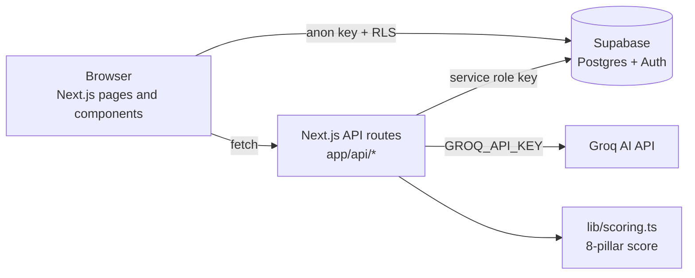

# System Architecture

## Layers

| Layer | Location | Responsibility |
| --- | --- | --- |
| UI | `app/`, `components/` | Professor and student pages |
| API | `app/api/` | Signup, AI grading, recommendations, AI card, assignment delete |
| Domain logic | `lib/scoring.ts`, `lib/marks.ts`, `lib/recommendations.ts` | Scoring and marks calculations |
| Data | `supabase/*.sql` | Tables and Row Level Security |

## Security notes

- `SUPABASE_SERVICE_ROLE_KEY` and `GROQ_API_KEY` are used only in server routes.
- The browser uses the Supabase anon key, restricted by RLS policies.
- Professor-only API routes check the caller's identity and ownership (401/403).

## Request flow: AI grading

1. Professor triggers grading for a submission.
2. `POST /api/assignments/grade` verifies the user owns the assignment.
3. The route loads questions and answers, then calls Groq.
4. If Groq is unavailable, a baseline fallback grader is used.
5. Results are written back to `assignment_submissions` / `assignment_answers`.
