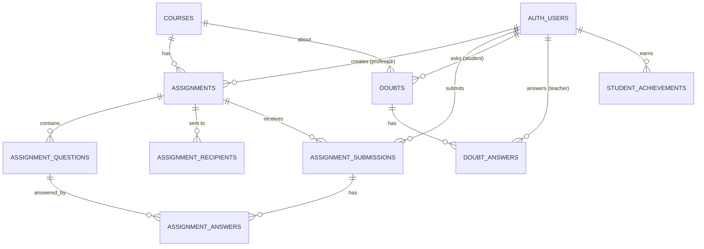

# Database Design

Tables defined in the three files under `supabase/`. `courses` and `auth.users`
are referenced but not created by these files.

## Files and tables

| SQL file | Tables |
| --- | --- |
| `assignments_and_ai_evaluation.sql` | assignments, assignment_questions, assignment_recipients, assignment_submissions, assignment_answers |
| `doubt_resolution.sql` | doubts, doubt_answers |
| `overall_performance_achievements.sql` | student_achievements |

## Delete behaviour

Most foreign keys use `ON DELETE CASCADE`, so deleting an assignment removes its
questions, recipients, submissions and answers. `assignment_recipients.student_user_id`
uses `ON DELETE SET NULL`.
